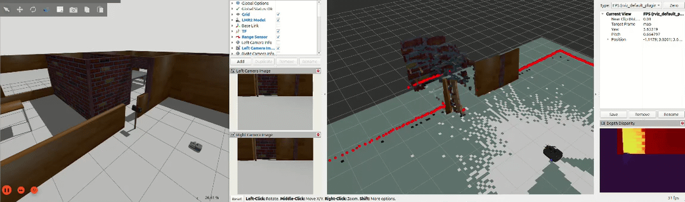

<div align="center">

# LENNA Mobile Robot Simulation
[](https://releases.ubuntu.com/jammy/) [](https://docs.ros.org/en/humble/index.html) [](http://wiki.ros.org/noetic) [](https://gazebosim.org/api/gazebo/6/)  
</div>

<div align="justify">

LENNA Mobile Robot is a differential-drive mobile robot platform intended for research and education. The repository maintains equivalent ROS1 and ROS2 simulations to support both legacy and modern robotics workflows.

<p align="center">
  
</p>

</div>

## ROS2 &nbsp;&nbsp; [](https://releases.ubuntu.com/jammy/) [](https://docs.ros.org/en/humble/index.html) [](https://gazebosim.org/api/gazebo/6/)

#### Requirements

- Ubuntu 24.04 (Noble)
- [ROS2 Jazzy](https://docs.ros.org/en/jazzy/Installation.html) (Desktop install)
- Gazebo Harmonic (installed with `ros-jazzy-ros-gz`)
- `colcon` and `rosdep`

Install the core simulation dependencies (Gazebo bridges, robot description tools, and the TurtleBot3 worlds):

```bash
$ sudo apt update
$ sudo apt install -y \
    python3-colcon-common-extensions python3-rosdep \
    ros-jazzy-ros-gz \
    ros-jazzy-xacro \
    ros-jazzy-robot-state-publisher \
    ros-jazzy-joint-state-publisher-gui \
    ros-jazzy-tf2-ros \
    ros-jazzy-rviz2 \
    ros-jazzy-teleop-twist-keyboard \
    ros-jazzy-turtlebot3-gazebo
```

Install the SLAM and navigation dependencies (`slam_toolbox` and Nav2):

```bash
$ sudo apt install -y \
    ros-jazzy-slam-toolbox \
    ros-jazzy-navigation2 \
    ros-jazzy-nav2-bringup
```

Install the stereo depth and point cloud dependencies:

```bash
$ sudo apt install -y \
    ros-jazzy-cv-bridge \
    ros-jazzy-message-filters \
    python3-opencv \
    python3-numpy
```

Alternatively, you can resolve any remaining package dependencies with `rosdep` from the root of your workspace:

```bash
$ sudo rosdep init   # only needed once per machine
$ rosdep update
$ rosdep install --from-paths src --ignore-src -r -y --rosdistro jazzy

#### Quick Start

Copy the `lmr2_description` and `lmr2_stereo_depth` package from this repository into your ROS workspace and build the package with `colcon`.

```bash
$ colcon build --symlink-install --packages-select lmr2_description lmr2_stereo_depth
$ source install/setup.bash
```


##### 🖥️ RViz Display

To visualize the LMR2 URDF model in RViz2, use the `display.launch.py` file:

```bash
$ ros2 launch lmr2_description display.launch.py
```

##### 🎮 Gazebo Simulation Turtlebot House

To spawn the LMR2 robot in Gazebo using the default TurtleBot world, launch `gazebo.launch.py`:

```bash
$ ros2 launch lmr2_description gazebo.launch.py world:=turtlebot3_house x:=1.5 y:=-2.5 yaw:=1.57
```
##### 🗺️ SLAM and Navigation Implementation

SLAM and autonomous navigation with Nav2 run as three separate processes. Open **three terminals**, source the workspace in each, and start them in the following order.

**Terminal 1: Gazebo simulation**

Start the simulation first and wait until the robot has spawned in the world:

```bash
$ ros2 launch lmr2_description gazebo.launch.py
```

**Terminal 2: SLAM**

Start `slam_toolbox` to build the map and publish the `/map` topic and the `map → odom` transform:

```bash
$ ros2 launch lmr2_description slam.launch.py
```

**Terminal 3: Nav2 navigation**

Start the Nav2 stack for path planning and control:

```bash
$ ros2 launch lmr2_description nav2.launch.py
```

When all three are running, use the **2D Goal Pose** tool in RViz2 to send a navigation goal. The robot plans a path, drives to the goal, and expands the map as it explores.

> [!NOTE]\
> Keep the launch order: Gazebo first, then SLAM, then Nav2. Nav2 relies on the `/map` topic and `map → odom` transform from `slam_toolbox`, so it will not activate until the simulation and SLAM are up. Nav2 parameters can be changed in `lmr2_description/config/nav2_params.yaml` or passed with `params_file:=<path>`.

##### 📷 Depth Sensing and Point Cloud

The `lmr2_stereo_depth` package computes depth and a 3D point cloud from the simulated stereo camera pair. It attaches to an **already running** simulation and does not start Gazebo itself, so launch Gazebo first and then start the stereo depth module in a new terminal:

```bash
# Terminal 1
$ ros2 launch lmr2_description gazebo.launch.py

# Terminal 2
$ ros2 launch lmr2_stereo_depth lmr2_stereo_sim.launch.py
```

Add `rviz:=true` to open the depth visualization in RViz2. Processing parameters are read from `lmr2_stereo_depth/config/stereo_depth.yaml` and can be overridden with `params_file:=<path>`. The depth module can also run alongside SLAM and Nav2 in a fourth terminal.


## ROS and Gazebo Classic &nbsp;&nbsp; [](https://releases.ubuntu.com/focal/) [](http://wiki.ros.org/noetic) [](https://classic.gazebosim.org/)
 
The ROS1 version provides a complete simulation environment for the LMR1 platform using the ROS Noetic ecosystem.

#### Quick Start

Copy the `lmr1_description` package from this repository into your ROS workspace and build the package.

```bash
$ catkin build lmr1_description
$ source devel/setup.bash
```

##### 🖥️ RViz Display

To visualize the LMR1 URDF model in RViz, use the `display.launch` file:

```bash
$ roslaunch lmr1_description display.launch
```

##### 🎮 Gazebo Simulation Turtlebot World

To spawn the LMR1 robot in Gazebo using the default TurtleBot world, launch `gazebo.launch`:

```bash
$ roslaunch lmr1_description gazebo.launch
```

##### 🗺️ SLAM Implementation

<table>
<tr>
<td width="50%" valign="top">

<div align="justify">
  
You can run `gmapping.launch` or `hector.launch` to demonstrate the GMapping and Hector SLAM algorithms, respectively.

</div>

```bash
$ roslaunch lmr1_description gmapping.launch
```

```bash
$ roslaunch lmr1_description hector.launch
```

</td>
<td width="50%" valign="top">
  
<p align="center">
  
</p>

</td>
</tr>
</table>

##### 🧭 AMCL Localization and Navigation Stack

<table>
<tr>
<td width="50%" valign="top">

<div align="justify">
  
You can run `navigation.launch` to demonstrate the `amcl` and `move_base` packages through ROS Navigation Stack:

</div>

```bash
$ roslaunch lmr1_description navigation.launch
```

</td>
<td width="50%" valign="top">
  
<p align="center">
  
</p>

</td>
</tr>
</table>

## Citation

If you use this code or build upon this work, please cite:

```bibtex
@INPROCEEDINGS{11213761,
  author={Riazati, Erfan and Hajizadeh, Arian and Esmaeilzadeh, Seyed Majid},
  booktitle={2025 33rd International Conference on Electrical Engineering (ICEE)}, 
  title={Design and Implementation of a Modular ROS-Based Mobile Robot with Hierarchical Control}, 
  year={2025},
  volume={},
  number={},
  pages={1038-1043},
  keywords={Visualization;Simultaneous localization and mapping;Navigation;Computer architecture;Real-time systems;Hardware;Mobile robots;Synchronization;Tuning;Testing;mobile robot;hierarchical control;distributed control;navigation;SLAM;ROS},
  doi={10.1109/ICEE67339.2025.11213761}}

```

</div>
